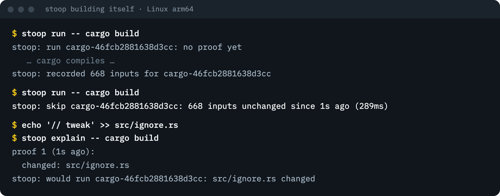

<p align="center">
  <a href="https://jwaldrip.github.io/stoop/">
    <picture>
      <source media="(prefers-color-scheme: dark)" srcset="assets/stoop-logo-on-dark.svg">
      
    </picture>
  </a>
</p>

<h3 align="center">Run only what matters.</h3>

<p align="center">
  Wrap a command. <b>stoop</b> traces every file it reads, and skips it when none of them changed since it last passed.<br>
  No input lists to write, and none to keep current.
</p>

<p align="center">
  <a href="https://jwaldrip.github.io/stoop/">Website</a> &middot;
  <a href="https://jwaldrip.github.io/stoop/docs/getting-started.html">Field guide</a> &middot;
  <a href="https://jwaldrip.github.io/stoop/docs/ci.html">CI recipes</a> &middot;
  <a href="https://jwaldrip.github.io/stoop/docs/cli.html">CLI reference</a>
</p>

<p align="center">
  <a href="https://github.com/jwaldrip/stoop/actions/workflows/ci.yml"></a>
  
  <a href="LICENSE"></a>
</p>

<p align="center">
  
</p>

## Most of a pipeline has nothing new to say

CI reruns every step on every push. Most of those steps read the same files they read last time and reach the same answer. When agents push all day, that waste compounds.

A stoop is a peregrine's hunting dive: it folds in, ignores the rest of the sky, and drops on the one thing that matters. **stoop** does that for CI. It picks out the step whose inputs moved and skips the rest.

<p align="center">
  
</p>

<p align="center"><sub>Captured, not typed: a fresh clone of stoop building itself, Linux arm64 in a throwaway container, stoop at <code>c9082e1</code>. Only cargo's progress lines are cut.</sub></p>

## How it works

1. **Watch.** The command runs under a tracer (ptrace plus a seccomp filter, so only file system calls stop). Every path the process tree opens, executes, looks up or lists is noted.
2. **Record.** When the command passes, stoop writes a proof: each path with a hash of every byte, files looked for and absent, directory listings, symlink targets, the environment, and what the run wrote inside the repository.
3. **Compare.** Next time it hashes the same paths. If all of them match and the outputs are still in place, the command is skipped.
4. **When unsure, run.** No proof, an expired proof, a trace that might be incomplete, a read of `.git`, or use of the network: the command runs and nothing is recorded.

Proofs are content-addressed and keyed by command, so a branch that matches what main already proved can skip. Up to 8 are kept per command, so steps that leave no output in the repository (tests, lint, type checks) also skip after a revert.

## Two lines in GitHub Actions

Put this at the top of a workflow and every `run:` step goes through stoop:

```yaml
defaults:
  run:
    shell: stoop sh {0}
```

Each step is keyed by its script, the workflow and the job. Steps that use an action run as usual; the step that installs stoop sets `shell: bash` for itself. Share proofs between runs through your own git remote (`--sync git`, no server to host) or by caching `.stoop/` with the CI's own cache. Pull requests read; only the default branch writes.

Full workflows for GitHub Actions, GitLab CI, CircleCI and Buildkite are in the [CI recipes](https://jwaldrip.github.io/stoop/docs/ci.html).

## Experimental job planning

`stoop plan` can evaluate recorded job proofs before other runners start. **Do not enable plan-skips in workflow gates yet.** A floating action ref can move between the runner downloading the action and stoop resolving it. The owner has not accepted that window, and the downloaded action is not verified against the resolved commit. `STOOP_STRICT_ACTIONS=1` makes jobs with floating `uses:` refs unplannable; it does not pin tools downloaded by those actions.

The planner requires an attested record from the planned workflow's own job, a protected branch, a GitHub-hosted runner and the same repository and owner IDs. It fails wide when it cannot establish a match. Publishing jobs need `id-token: write` and access to the shared git proof store. Any code in a publishing job that can request an OIDC token can attest records for another job in that workflow. Records whose signing key is no longer published are rejected.

The plan job must be in the top-level workflow. Set `STOOP_JOB_WORKFLOW_REF: ${{ job.workflow_ref }}` on the plan step; the planner refuses a missing or mismatched value in Actions. Container image `ENV` must not set `STOOP_*` controls, and neutral setup must not change them through `GITHUB_ENV`. These are assumptions, not checks. Jobs with nonempty `container.options` are unplannable.

Set `STOOP_ALLOW_USES` in workflow or job environment to a comma- or newline-separated list of exact `owner/repo` or `owner/repo@ref` actions. This asserts that each listed action is side-effect free; the workflow author is responsible for that assertion. Refs are still resolved and checked, and `STOOP_STRICT_ACTIONS` still applies. The `--allow-uses` flag is for local dry runs only. Supply `STOOP_ENV_SALT` to the plan job and recorded jobs alike when using salted proofs.

| Input | Plan-time handling |
|---|---|
| Repository inputs | Compared against the selected git tree and earlier recorded step outputs |
| State before a recorded write | Compared before applying its outputs; unknown prior state makes the job run |
| Files outside the repository and most runner environment | Assumed under the job definition and maximum age, not checked on the plan runner |
| GitHub event payload and known GitHub variables | Compared with the plan job's values |
| Probe or unknown setup | The job runs |

The default maximum age is seven days; `stoop plan --max-age` can set a shorter, positive ceiling. A trusted full run should re-prove jobs regularly. The planner does not restore outputs or run probes.

JSON output has schema `stoop.plan/1`: top-level `workflow`, `path`, `rev`, `plan_job`, `full`, `skip` and `jobs`. Each job has `id`, `gated`, `decision`, `code`, `detail` and `legs`. Each leg includes its key, decision, record, checked counts, assumed input counts and the first mismatch when available. In GitHub format, `skip` is a comma-delimited output such as `,test,`; the full JSON is also emitted when it fits the output limit.

## Install

```sh
cargo install --locked --git https://github.com/jwaldrip/stoop
```

Prebuilt binaries aren't published yet. Tracing needs Linux on x86-64 or arm64; on macOS stoop builds and runs the command untraced, so a workflow stays portable but never skips there.

```sh
stoop run -- cargo test        # skip or run
stoop explain -- cargo test    # say what would run and why (exit 1 if it would run)
stoop ls                       # list proofs
```

## What it sees, and what it can't

| Counts as an input | How |
|---|---|
| Files read, executed, looked up or listed | Traced; every byte hashed, inside the repository and out |
| A file that was absent and appears | Recorded as absent inside the repository |
| The environment | Every variable, minus runner bookkeeping; `--ignore-env NAME` exempts one |
| External state you can check | `--probe CMD`: its output must match for a skip |
| What the run wrote in the repository | Must still be in place for a skip; throwaway output goes in `.stoopignore` |

stoop sees files. It can't see:

- **The network.** A run that connects out isn't recorded, and stoop names where it connected. Cover it with `--probe`, or pass `--allow-network`.
- **The clock and randomness.** Proofs expire after 7 days (`--max-age`), and `STOOP_FULL=1` re-proves everything. Run that nightly.
- **Services outside the process tree**, and output written outside the repository.

[Blind spots and how to cover them](https://jwaldrip.github.io/stoop/docs/blind-spots.html)

## Declared inputs, observed inputs

Build caches have to know what a task depends on. Most are told; stoop finds out.

| Tool | How it learns what a task depends on |
|---|---|
| Bazel | Each target declares its sources and dependencies in BUILD files ([docs](https://bazel.build/concepts/dependencies)) |
| Nx | Hashes a target's configured inputs: file sets, runtime values and environment variables ([docs](https://nx.dev/docs/reference/inputs)) |
| Turborepo | Hashes every git-tracked file in the package by default; `inputs` narrows it ([docs](https://turborepo.dev/docs/crafting-your-repository/configuring-tasks)) |
| `actions/cache` | You compose the key, usually from `hashFiles()` over globs you choose ([docs](https://docs.github.com/en/actions/reference/workflows-and-actions/dependency-caching)) |
| **stoop** | Traces the files the command actually opened, executed, looked up or listed |

Those tools do things stoop doesn't, like task graphs, restoring cached outputs and, in Bazel's case, remote execution. stoop is one binary around one command, and it works inside any of them.

## Roadmap

Not built yet. Today a skip needs byte-equal inputs; the plan loosens that only where it can be shown not to hide a change:

- **Equal build artifacts:** skip downstream steps when a rebuild produced the same bytes.
- **Normalized source:** ignore comment and whitespace edits, per language.
- **Coverage granularity:** tie a test to the code it actually ran.
- **A determinism check:** run twice at record time and refuse to record a step that disagrees with itself.
- **Static vetoes:** refuse to skip a step whose code calls the clock or a random source.
- **Restored outputs:** let a skip put back what the command produced.

[The roadmap, with the reasoning](https://jwaldrip.github.io/stoop/docs/roadmap.html)

## Documentation

The [field guide](https://jwaldrip.github.io/stoop/docs/getting-started.html) covers [getting started](https://jwaldrip.github.io/stoop/docs/getting-started.html), [how it works](https://jwaldrip.github.io/stoop/docs/how-it-works.html), [CI recipes](https://jwaldrip.github.io/stoop/docs/ci.html), [every flag](https://jwaldrip.github.io/stoop/docs/cli.html), [`.stoopignore`](https://jwaldrip.github.io/stoop/docs/stoopignore.html), [blind spots](https://jwaldrip.github.io/stoop/docs/blind-spots.html) and the [FAQ](https://jwaldrip.github.io/stoop/docs/faq.html). The site's source is in [`site/`](site/).

## Build

```sh
cargo build --release
cargo test        # the end-to-end tests need Linux
```

MIT licensed.
